## Microsoft 365 Administration 

This repository documents practical labs completed while studying Microsoft 365 administration and Microsoft Entra ID. Screenshots are included as evidence of configuration and validation.

## Environment

- **Platform:** Microsoft Entra admin center / Microsoft 365 admin center
- **Focus:** Identity and access management, users, groups, licensing, administrative roles, MFA, Conditional Access, and device management
- **Evidence:** Screenshots captured during hands-on lab work

## 1. User management

### Objective
Practise common identity lifecycle tasks: creating accounts, deleting and restoring a user, and resetting a password.

### Why it matters
User lifecycle management is a core Microsoft 365 administration responsibility. These tasks help ensure that access can be provisioned, removed, recovered, and maintained appropriately.

### User accounts created

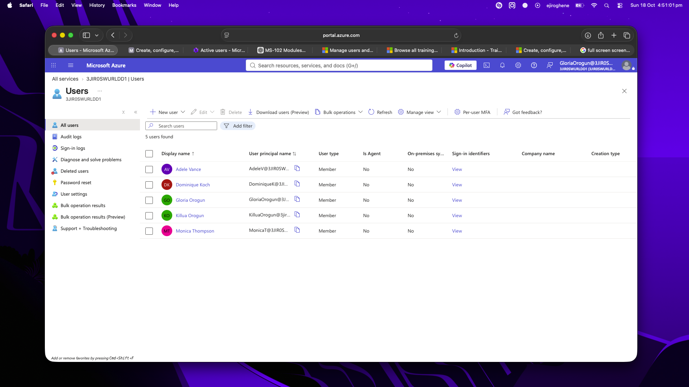

*Figure 1.1 Users Created  — User accounts created.*

### Deleting a user

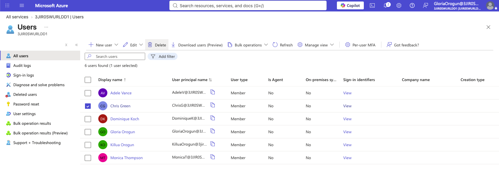

*Figure 3.1 deleting a user — Deleting a user.*

### Restoring a deleted user

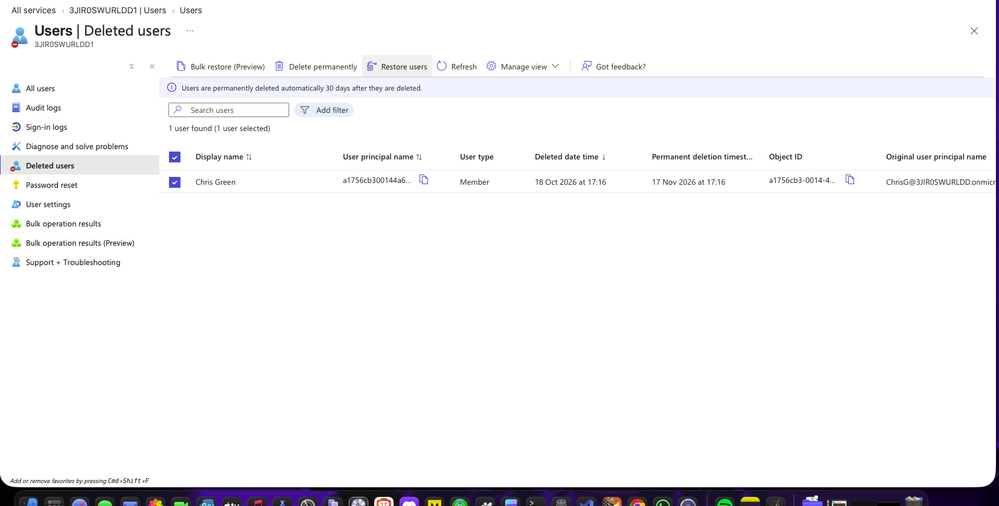

*Figure 3.2 restoring a deleted  user  — Restoring a deleted user.*

### Deleted user restored

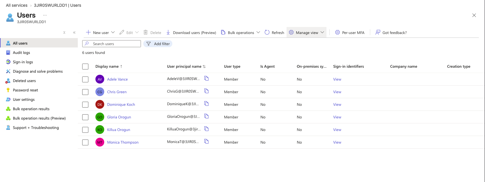

*Figure 3.1b delted user restored — Deleted user restored.*

### Resetting a user's password

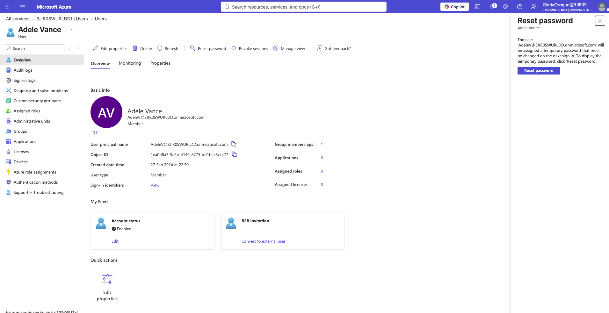

*Figure 6.1 Reset a users password  — Resetting a user's password.*

## 2. Groups and licensing

### Objective
Create security and Microsoft 365 groups, add users, assign licences through group-based licensing, and practise unassigning group licences.

### Why it matters
Groups simplify access and licence administration. Group-based assignment helps administrators manage users consistently and reduces repetitive manual changes.

### Creating a security group

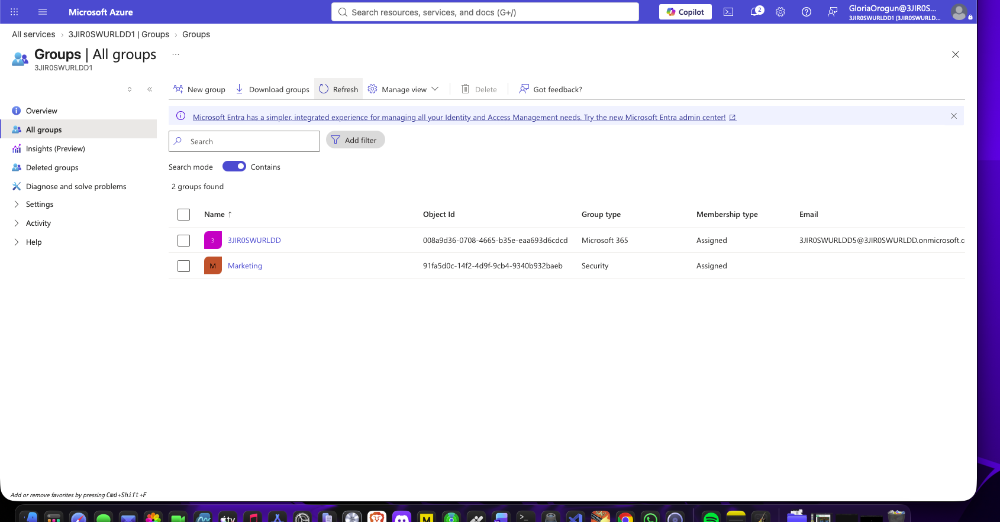

*Figure 2.1a creating a security group  — Creating a security group.*

### Creating a security group and adding users

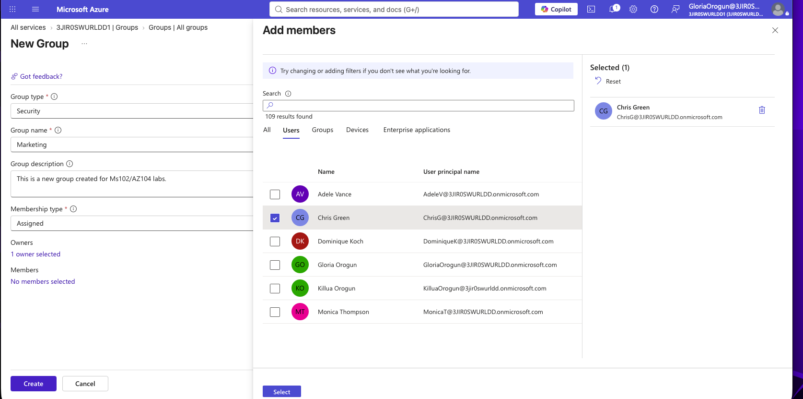

*Figure 2.1 Creating a security group and adding users to it — Creating a security group and adding users.*

### Assigning licences to a group

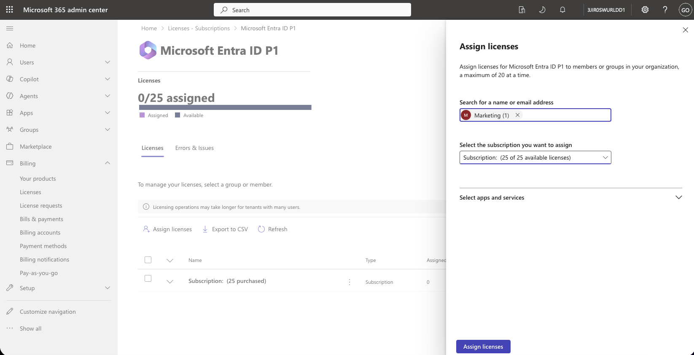

*Figure 2.2 assign liscences to a group  — Assigning licences to a group.*

### Group licence assignment evidence

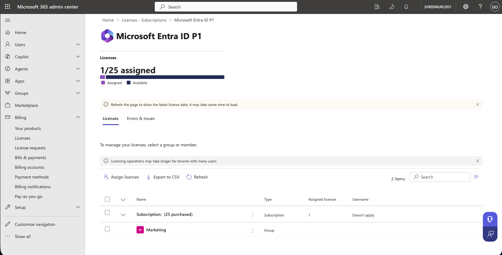

*Figure 2.2a assign liscenses to a group  — Group licence assignment evidence.*

### Unassigning licences from a group

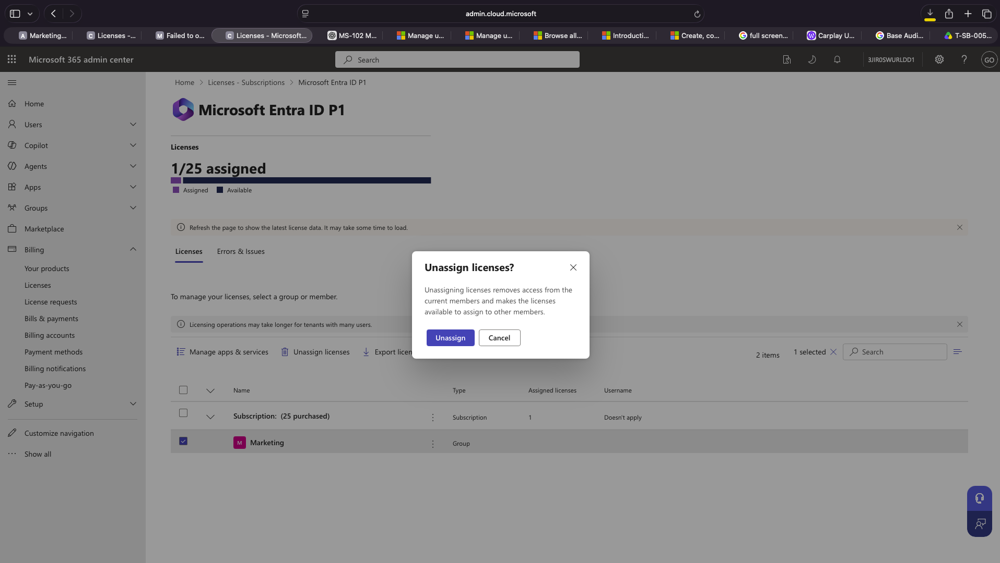

*Figure 2.3a unassign liscenses froma group  — Unassigning licences from a group.*

### Creating a Microsoft 365 group

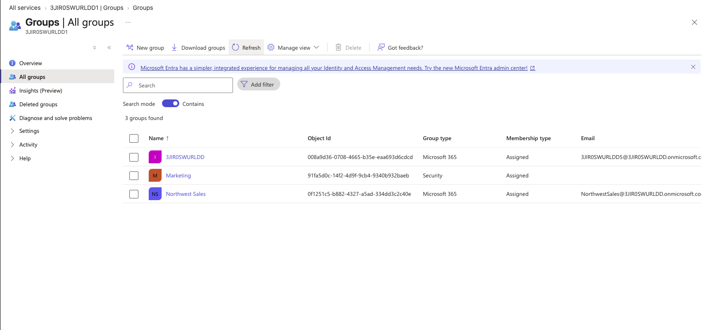

*Figure 4.1a Create a microsoft365 group — Creating a Microsoft 365 group.*

### Microsoft 365 group

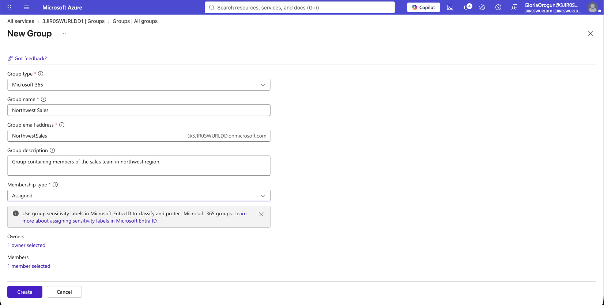

*Figure 4.1 create a microsoft 365 group  — Microsoft 365 group.*

## 3. Administrative roles

### Objective
Assign an administrative role and export role-assignment information for review.

### Why it matters
Role-based access control supports least privilege: administrators should receive only the permissions needed for their responsibilities. Role assignments should be reviewed and documented.

### Role assignment

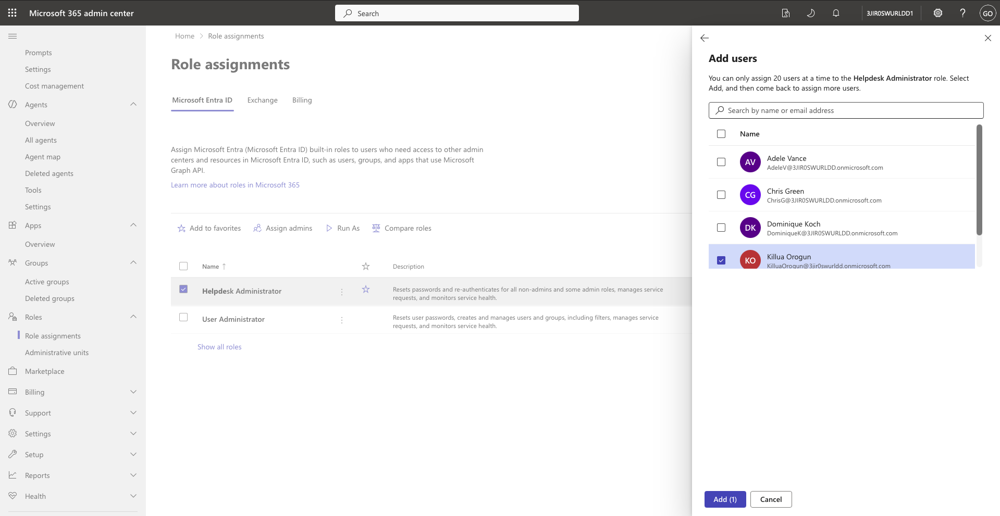

*Figure 7.1a assing a role  — Role assignment.*

### Assigning a role

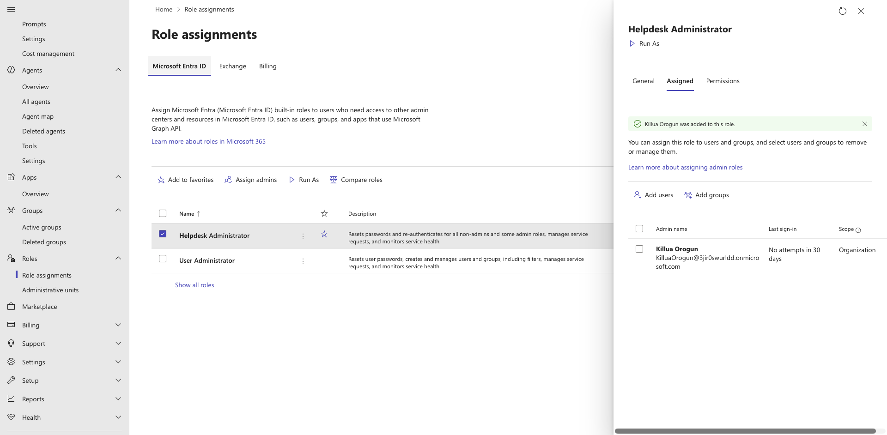

*Figure 7.2 assign a role  — Assigning a role.*

### Exporting role assignment evidence

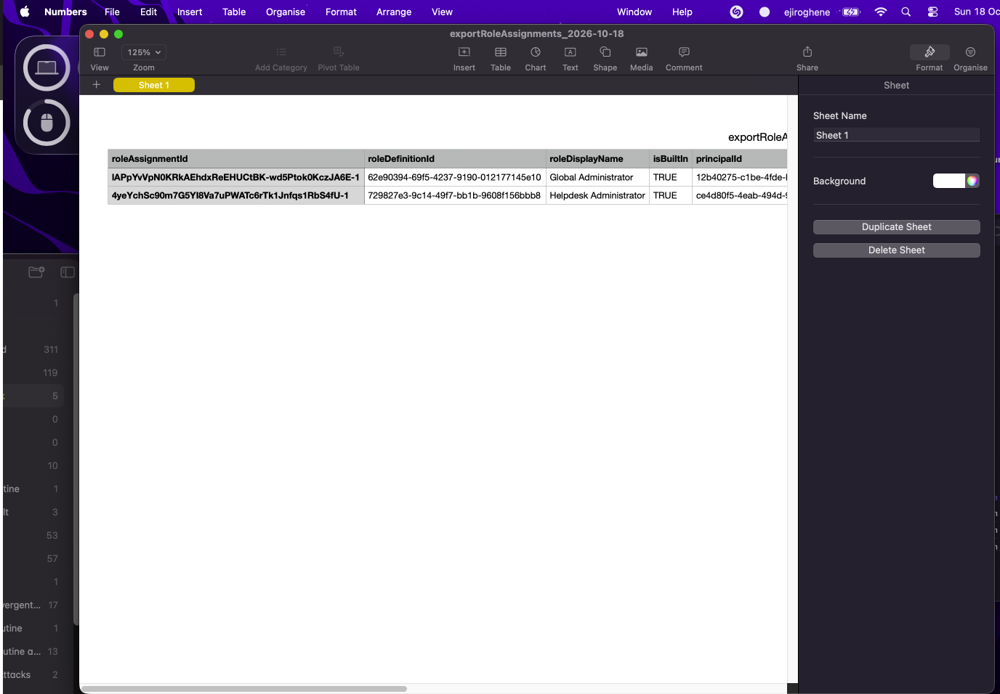

*Figure 7.3 role assignment exported as csv  — Exporting role assignment evidence.*

## 4. Multifactor authentication (MFA)

### Objective
Review authentication-method settings, register Microsoft Authenticator for a dedicated test account, and review app-password concepts for applications that do not support modern MFA.

### Why it matters
MFA adds an additional verification step to help protect accounts if a password is compromised. Method registration and MFA enforcement are separate tasks; registering an authenticator alone does not prove that an MFA policy is enforced.

### Authentication methods configured

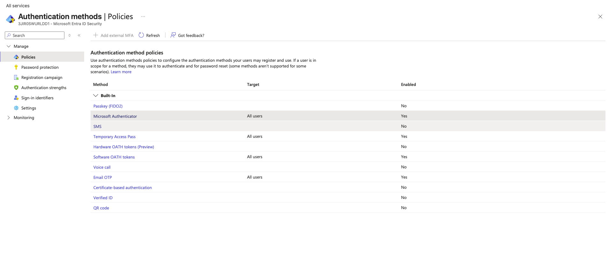

*Figure 8.1 configured MFA authentication methods  — Authentication methods configured.*

### Microsoft Authenticator registered successfully

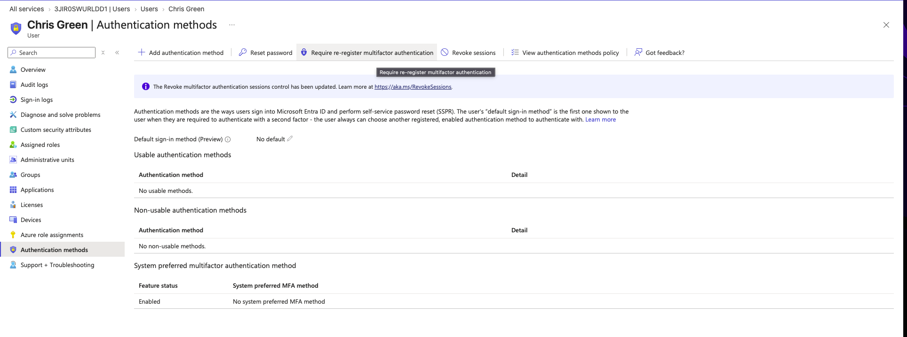

*Figure 8.2. microsoft authenticator registerd succesfully  — Microsoft Authenticator registered successfully.*

### App password for an application that does not support MFA

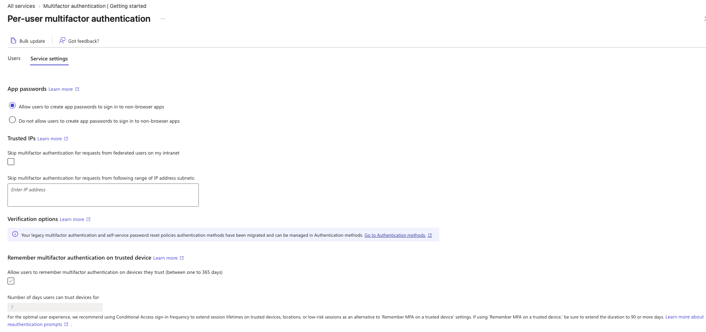

*Figure 5. configure mfa :app password for apps that dont support multifactor authentication  — App password for an application that does not support MFA.*

## 5. Conditional Access — block macOS access

### Objective
Create a Conditional Access policy scoped to a dedicated test user, target Microsoft Admin Portals, include the macOS device platform, and select **Block access**.

### Configuration and safety
- **Target user:** Dedicated test account; keep the administrator account excluded.
- **Target resource:** Microsoft Admin Portals.
- **Device platform:** macOS.
- **Grant control:** Block access.
- **Policy state:** Report-only.

### Validation
The sign-in log's Report-only tab showed **Report-only: Failure** for the block control. This indicates that the policy would have blocked that sign-in if enforced, provided the event was the intended macOS sign-in and the policy matched it. The policy remained in Report-only mode, so access was evaluated but not blocked by this policy.

### Why it matters
Conditional Access combines identity, resource, device-platform, and access-control conditions to make access decisions. Report-only mode helps administrators evaluate the expected impact before enforcing a policy.

### Conditional Access policy configured in Report-only mode

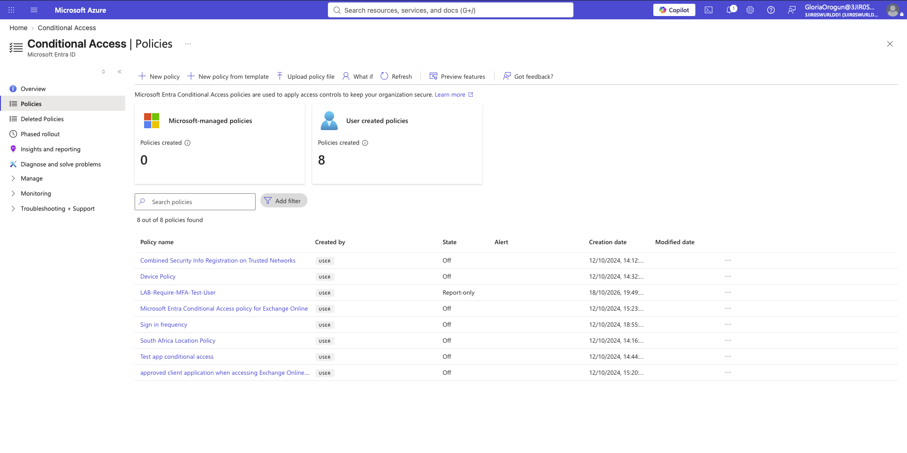

*Figure 9.2 conditiona access policy:polcies configured but in report-only mode  — Conditional Access policy configured in Report-only mode.*

### Policy configuration and test scope

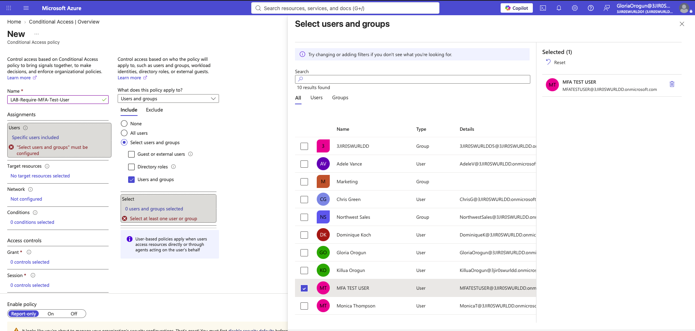

*Figure 9.1 Configure Conditional Access Policy, test usinga test user and one user asigned global admin so can never be locked out and in report-only mode — Policy configuration and test scope.*

### Report-only evaluation: sign-in would have been blocked

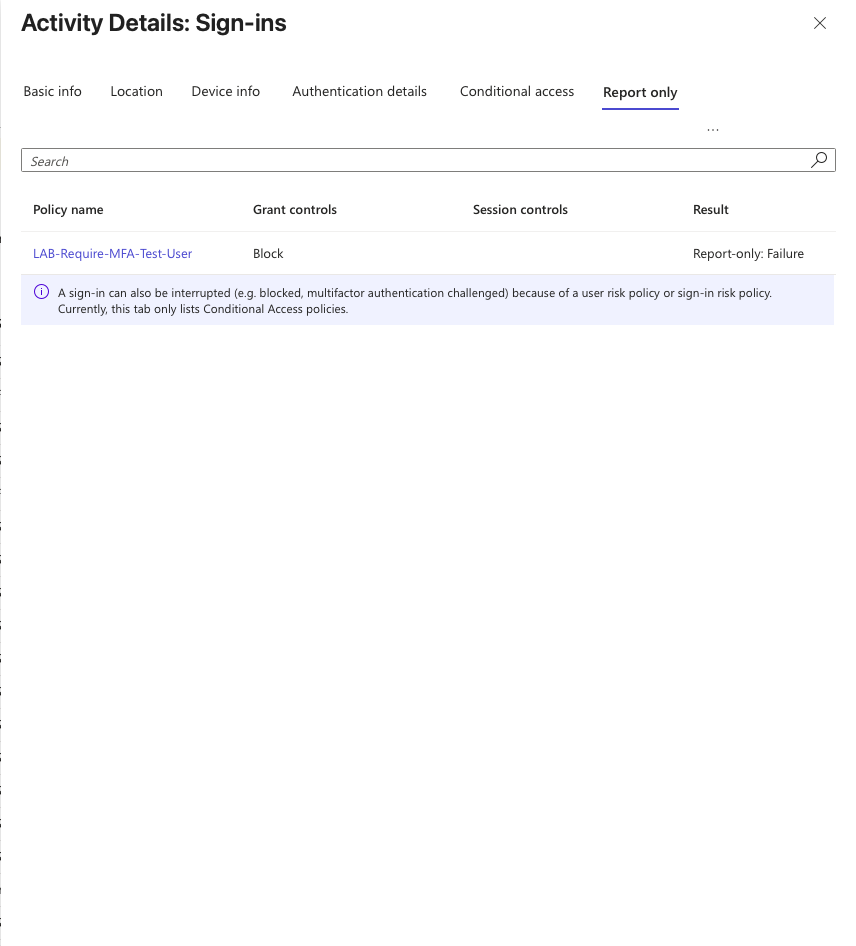

*Figure 9.3 result achieved, it would have blocked that sign in.  — Report-only evaluation: sign-in would have been blocked.*

## 6. Join a Windows device to Microsoft Entra ID — pending

### Objective
Join a Windows device to Microsoft Entra ID and verify the resulting device identity and join state.

### Planned steps
- [ ] Confirm the Windows device and tenant prerequisites.
- [ ] Join the device to Microsoft Entra ID.
- [ ] Verify the join status on the device and in the Entra admin center.
- [ ] Capture screenshots of the join process and successful verification.
- [ ] Add the screenshots and final results below.

### Evidence

Add screenshots here after completing the lab.

_Evidence screenshots to be added here after completing the lab._

### Result

_To be completed after the Windows device join lab is performed and verified._

## Key learning outcomes

- Managed user accounts and password recovery.
- Created and managed groups and group-based licence assignments.
- Practised administrative role assignment and reviewed role-assignment evidence.
- Configured authentication methods and registered Microsoft Authenticator for a test user.
- Built and evaluated a macOS Conditional Access block policy in Report-only mode.
- Windows device join evidence will be added after that lab is completed.

## Notes

- Screenshots are linked using relative paths in `Evidence/`; keep that folder beside this `README.md` in the repository.
- This README documents lab practice, not production deployment.
